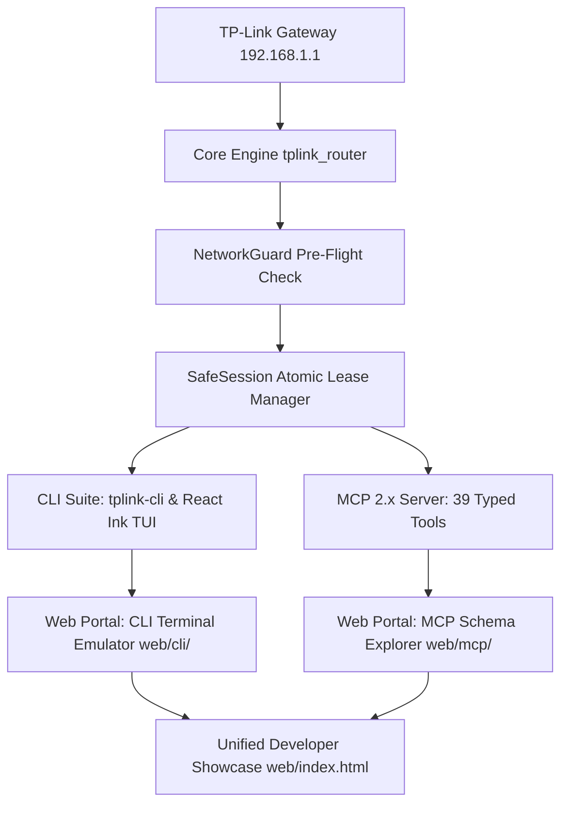

<p align="center">
  <a href="https://github.com/dulithdivisekara/tplink-router-suite" target="_blank" rel="noopener noreferrer">
    
  </a>
</p>

<h1 align="center">TP-Link Router Suite</h1>

<p align="center">
  Universal engineering monorepo for TP-Link routers: Production CLI with React Ink TUI, 39-tool Model Context Protocol (MCP 2.x) server, and interactive developer web showcase.
</p>

<p align="center">
  <a href="https://www.python.org/"></a>
  <a href="https://www.npmjs.com/package/tplink-router-suite"></a>
  <a href="https://modelcontextprotocol.io/"></a>
  <a href="#"></a>
  <a href="LICENSE"></a>
</p>

<p align="center">
  <a href="#overview">Overview</a> &bull;
  <a href="#architecture--modes">Architecture</a> &bull;
  <a href="#project-structure">Structure</a> &bull;
  <a href="#installation">Installation</a> &bull;
  <a href="#cli-suite-guide">CLI Guide</a> &bull;
  <a href="#mcp-server-guide">MCP Guide</a> &bull;
  <a href="#web-showcase--portal">Web Portal</a> &bull;
  <a href="#session-logging--inspection">Logging</a> &bull;
  <a href="#verification-tests">Testing</a> &bull;
  <a href="#security--governance">Security</a> &bull;
  <a href="#license">License</a>
</p>

## Overview

TP-Link Router Suite is a single, production-grade monorepo unifying reverse-engineered protocol implementations (TR-064 / AES-128 / RSA-1024), human-facing command-line tools, and agentic Model Context Protocol (MCP 2.x) servers across TP-Link 4G/LTE gateways and broadband routers.

Conceived in Malabe, Sri Lanka near the SLIIT Campus, this system was developed to solve acute cellular routing drops, tower flapping, and bufferbloat on Hutch 4G LTE unlimited packages using TP-Link Archer MR200 gateways. To operate safely across university infrastructure, mobile hotspots, and private residential networks, the suite features a zero-trust multi-environment network guard that audits default gateways and SSIDs prior to dispatching mutations.

Key capabilities include atomic single-admin session leasing (`SafeSession`), live 3GPP cellular telemetry extraction (RSRP, RSRQ, SNR, EARFCN, PCI), automated cell tower locking, carrier band selection, host-side TCP BBR optimization, and an interactive Terminal UI built with React 19 and Ink.

## Architecture & Modes

The monorepo organizes communication with TP-Link hardware into four discrete operational interfaces, ensuring non-overlapping session lifecycles and thread-safe lock management.

| Operational Interface | Runtime Engine | Terminal Rendering | Session Model | Primary Deliverable |
| :--- | :--- | :--- | :--- | :--- |
| **Ink React TUI** | Node.js 18+ / React 19 | Full-screen Yoga v3 Flexbox | Live Async Event Loop | Interactive monitoring dashboard |
| **Python TUI Fallback** | Pure Python 3.10+ / Rich | Standard ANSI buffer | Sequential polling | Environments without Node.js |
| **Subcommand CLI** | Native Binary / Script | Plain text stdout / JSON | Atomic single-command lease | Automation scripts and cron jobs |
| **MCP 2.x Server** | Python stdio / JSON-RPC | Headless RPC stream | Atomic SafeSession leasing | AI assistants (Antigravity, Claude, Cursor) |



## Project Structure

```
.
├── tplink_router/              # Core Python package (CLI, MCP, and protocol adapters)
│   ├── core/                   # Session leasing, crypto handshakes, network safety
│   ├── clients/                # Hardware-specific adapters (MR LTE vs Broadband)
│   ├── cli/                    # 31 CLI subcommands, theme engines, and REPL
│   ├── mcp/                    # MCP 2.x server exposing 39 typed tools
│   ├── calibration/            # Autonomous RF band sweep and calibration engine
│   └── models/                 # Typed telemetry and configuration models
├── bin/                        # Cross-platform Node.js launchers for npm/npx
│   ├── tplink-cli.js           # CLI dispatcher
│   └── tplink-mcp.js           # MCP stdio launcher
├── distribution/               # Multi-ecosystem packaging specifications
│   ├── Dockerfile              # Container definition for GHCR deployment
│   ├── smithery.yaml           # Smithery MCP registry manifest
│   ├── Formula/tplink-cli.rb   # Homebrew package tap formula
│   ├── debian/control          # Debian APT package definition
│   └── install.sh              # POSIX zero-dependency installation script
├── ink-src/                    # React 19 + Ink animated Terminal UI
├── docs/                       # Reverse-engineered endpoint catalog (95 endpoints)
├── scripts/                    # Network optimization, keepalive, and schema extractors
│   ├── optimize-network.sh     # TCP BBR, FQ, and MTU 1420 GTP clamping
│   ├── keepalive-pulse.sh      # 28-byte background cellular keepalive heartbeat
│   └── extract-catalog.py      # Automated schema sync into web portals
├── tests/                      # Unified automated test suite (90 unit tests)
├── web/                        # Unified Web Showcase & Documentation Portal
│   ├── index.html              # Unified Developer Portal
│   ├── cli/                    # Interactive CLI Terminal Simulator (33 subcommands)
│   ├── mcp/                    # MCP Schema Explorer & AI Config Generator (39 tools)
│   └── scripts/build.py        # Static generator and schema validator
├── CONTRIBUTING.md             # Developer workflow and pull request guidelines
├── SECURITY.md                 # Security policy and session leasing invariants
├── CODE_OF_CONDUCT.md          # Contributor Covenant v2.1
├── CHANGELOG.md                # Release history and migration guide
├── LICENSE                     # MIT License
├── package.json                # npm root manifest
├── pyproject.toml              # Python build configuration
└── README.md
```

## Installation

Select your preferred runtime or package manager:

### Python PyPI (pip / pipx)
```bash
# Install CLI and MCP server globally:
pip install tplink-router-suite

# Or run isolated:
pipx run tplink-router-suite tplink-cli status
```

### Node.js (npm / npx)
```bash
# Install globally:
npm install -g tplink-router-suite

# Or run directly on-demand:
npx tplink-router-suite tplink-cli status
```

### Homebrew (macOS & Linux)
```bash
brew tap dulithdivisekara/tap
brew install tplink-cli
```

### Debian / Ubuntu (APT Package)
```bash
curl -fsSLO https://tp-link-cli.dulith.me/tplink-cli_1.0.0_all.deb
sudo dpkg -i tplink-cli_1.0.0_all.deb
```

### Docker Container (Zero-Install MCP)
```bash
docker run -i --rm --network host \
  -e TPLINK_ROUTER_IP="http://192.168.1.1" \
  -e TPLINK_PASSWORD="your_router_password" \
  ghcr.io/dulithdivisekara/tplink-mcp:latest
```

### Zero-Dependency POSIX Installer
```bash
curl -fsSL https://tp-link-cli.dulith.me/install.sh | bash
```

## CLI Suite Guide

### Interactive React Ink Terminal User Interface
```bash
tplink-cli                  # Launch animated full-screen React Ink TUI (default in TTY)
tplink-cli --mono           # High-contrast Monochrome mode
tplink-cli --no-anim        # Disable transient animations and shimmer
tplink-cli --python-tui     # Use pure-Python fallback TUI engine
```

### Subcommands Overview
```bash
# Telemetry & Radio
tplink-cli status                         # Gateway, cellular, and WAN telemetry
tplink-cli status --json                  # Structured JSON output for scripts
tplink-cli signal                         # Live 3GPP RSRP, RSRQ, SNR metrics
tplink-cli profile check                  # Verify active Wi-Fi SSID and Gateway safety

# Cellular & Band Control
tplink-cli cell-lock                      # Query base station lock status
tplink-cli cell-lock --enable --earfcn 1550 --pci 58  # Lock modem to specific tower
tplink-cli band 3                         # Pin modem to LTE Band 3 (1800 MHz)
tplink-cli band auto                      # Restore dynamic carrier aggregation
tplink-cli data-limit                     # Show monthly cellular quota & live bandwidth

# Connected Devices & LAN
tplink-cli clients                        # List connected LAN devices (IP, MAC, Hostname)
tplink-cli reservation list               # Enumerate static DHCP reservations
tplink-cli reservation add AA:BB:CC:DD:EE:FF 192.168.1.50   # Add static IP binding

# Hardware & System
tplink-cli wifi                           # Query 2.4 GHz and 5 GHz wireless status
tplink-cli leds --night-mode on --start 23:00 --end 07:00   # Auto-disable front panel LEDs
tplink-cli diag                           # Run WAN reachability and link self-tests
tplink-cli reboot                         # Graceful router hardware restart
tplink-cli repl                           # Launch authenticated interactive shell
```

### Host-Side Cellular Performance Optimizer
```bash
# Apply TCP BBR congestion control, FQ queueing, and MTU 1420 GTP clamping
sudo ./scripts/optimize-network.sh enable

# Start 28-byte background keepalive heartbeat to avoid cellular dormancy
./scripts/keepalive-pulse.sh start
```

## MCP Server Guide

Connect TP-Link hardware directly to autonomous AI copilots with 39 typed tools.

### Claude Desktop Configuration
Add to your `claude_desktop_config.json`:
```json
{
  "mcpServers": {
    "tplink-router": {
      "command": "npx",
      "args": ["-y", "tplink-router-suite", "tplink-mcp"],
      "env": {
        "TPLINK_ROUTER_IP": "http://192.168.1.1",
        "TPLINK_PASSWORD": "your_router_password"
      }
    }
  }
}
```

### Google Antigravity & Cursor Configuration
Configure directly via Python stdio transport:
```json
{
  "mcpServers": {
    "tplink-router": {
      "command": "python3",
      "args": ["-m", "tplink_router.mcp.server"],
      "env": {
        "TPLINK_ROUTER_IP": "http://192.168.1.1",
        "TPLINK_PASSWORD": "your_router_password"
      }
    }
  }
}
```

### Selected MCP Tools Catalog
| Tool Name | Operation | Category | Safety Guard |
| :--- | :--- | :--- | :--- |
| `router_profile_check` | Read | Diagnostics | Safe |
| `router_get_status` | Read | Diagnostics | Safe |
| `router_get_rf_signal` | Read | Cellular | Safe |
| `router_set_cell_lock` | Write | Cellular | Requires confirm=True |
| `router_set_lte_band` | Write | Cellular | Requires confirm=True |
| `router_get_data_limit` | Read | Cellular | Safe |
| `router_get_connected_clients` | Read | Diagnostics | Safe |
| `router_manage_dhcp_reservation` | Write | Network | Requires confirm=True |
| `router_get_wifi_networks` | Read | Wi-Fi | Safe |
| `router_set_wifi_radio` | Write | Wi-Fi | Requires confirm=True |
| `router_run_diagnostic` | Exec | Diagnostics | Safe |
| `router_run_ussd` | Exec | Cellular | Safe |
| `router_read_sms` | Read | SMS | Safe |
| `router_send_sms` | Write | SMS | Safe |
| `router_reboot` | Exec | System | Requires confirm=True |

## Web Showcase & Portal

The `web/` directory houses the documentation showcase and interactive simulators:
- **Unified Portal (`web/index.html`)**: Developer hub connecting CLI and MCP portals.
- **CLI Terminal Simulator (`web/cli/`)**: Browser-based emulator demonstrating 33 subcommands and live benchmarks.
- **MCP Schema Explorer (`web/mcp/`)**: Mintlify-styled tool catalog with interactive modal schema inspection.

```bash
# Validate schemas and build pre-rendered HTML
python3 web/scripts/build.py

# Start local preview server
python3 -m http.server 8080 --directory web
```

## Session Logging & Inspection

Every command outputs audit records without leaking plaintext credentials:
- **Session Log**: `~/.config/tplink-router/session.log`
- **MCP Log**: `~/.config/tplink-router/mcp.log`
- **Config Storage**: `~/.config/tplink-router/config.json` (POSIX `0600` permissions)
- **Live Stream**:
  ```bash
  tail -f ~/.config/tplink-router/session.log
  ```

## Verification Tests

Execute the automated test suite verifying session leasing, multi-environment guards, TR-064 response parsing, and RF band calibration:

```bash
python3 -m unittest discover tests
```

```text
Ran 90 tests in 22.172s

OK
```

## Security & Governance

- [Security Policy](SECURITY.md): Vulnerability disclosure procedures and `SafeSession` atomic concurrency invariants.
- [Contributing Guide](CONTRIBUTING.md): Environment setup, PR guidelines, and coding standards.
- [Code of Conduct](CODE_OF_CONDUCT.md): Contributor Covenant v2.1 standards.
- [Changelog](CHANGELOG.md): Historical version releases and monorepo migration notes.

## License

This project is licensed under the [MIT License](LICENSE).
Author: [Dulith Divisekara](https://github.com/dulithdivisekara) (SLIIT Malabe, Sri Lanka).
