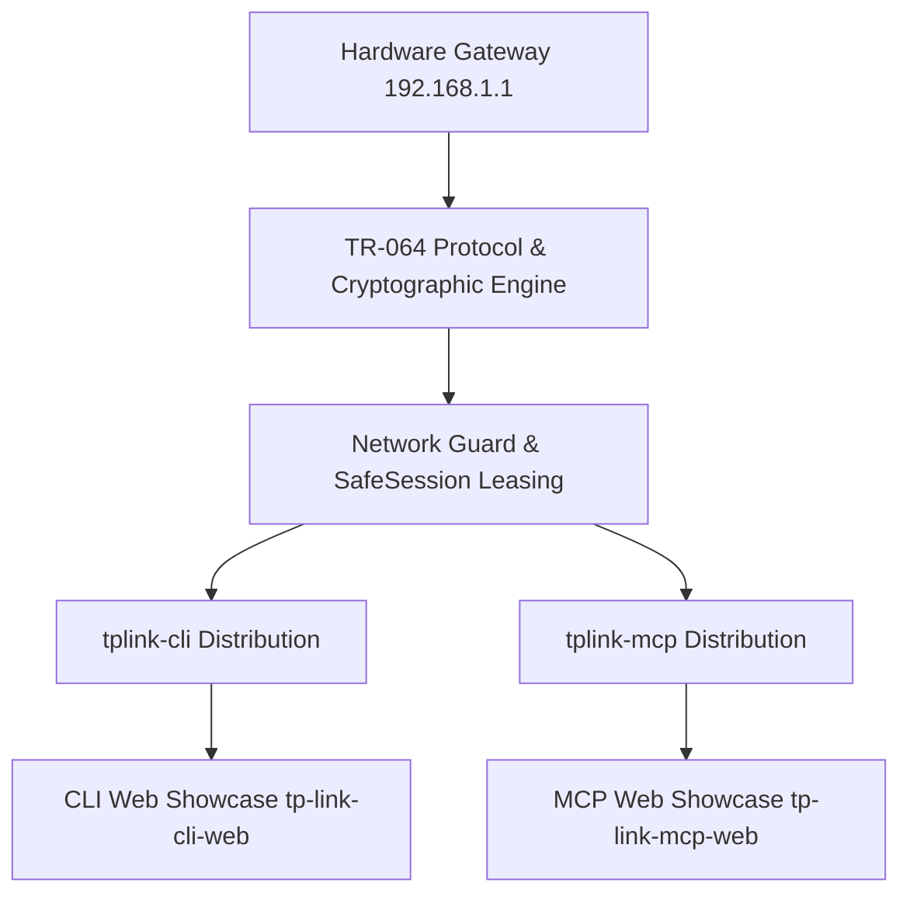

<p align="center">
  <a href="https://github.com/dulithdivisekara/tplink-router-builder" target="_blank" rel="noopener noreferrer">
    
  </a>
</p>

<h1 align="center">TP-Link Router Builder Core</h1>

<p align="center">
  Central upstream builder, TR-064 reverse engineering engine, cryptographic layer, and protocol specification monorepo for the TP-Link router ecosystem.
</p>

<p align="center">
  <a href="https://www.python.org/"></a>
  <a href="#"></a>
  <a href="#"></a>
  <a href="LICENSE"></a>
</p>

<p align="center">
  <a href="#overview">Overview</a> &bull;
  <a href="#architecture--modes">Architecture</a> &bull;
  <a href="#project-structure">Structure</a> &bull;
  <a href="#installation">Installation</a> &bull;
  <a href="#usage">Usage</a> &bull;
  <a href="#session-logging--inspection">Logging</a> &bull;
  <a href="#verification-tests">Testing</a> &bull;
  <a href="#security--privacy">Security</a> &bull;
  <a href="#license">License</a>
</p>

---

## Overview

TP-Link Router Builder is the canonical upstream source repository that engineers and maintains the protocol specifications, cryptographic adapters, and reverse-engineered TR-064 interfaces across the entire TP-Link router hardware ecosystem. It directly feeds and synchronizes downstream releases including `tplink-cli` and `tplink-mcp`.

Conceived in Malabe, Sri Lanka near the SLIIT Campus, this system addresses carrier routing fluctuations and tower flapping observed on Hutch 4G LTE connections using Archer MR200 gateways. To operate safely across university networks, personal hotspots, and home environments, the engine implements a zero-trust multi-environment network guard that audits default gateways and SSIDs prior to command execution.

Key capabilities include atomic single-admin session leasing (`SafeSession`), live 3GPP cellular telemetry extraction (RSRP, RSRQ, SNR, EARFCN, PCI), automated cell tower locking, carrier band selection, host-side TCP BBR optimization, and an upstream build pipeline covering 95 reverse-engineered router web endpoints.

---

## Architecture & Modes

The monorepo organizes protocol handling into distinct layers, ensuring that downstream consumers (CLI power users and autonomous AI agents) interact with router hardware through authenticated, non-overlapping sessions.

| Layer | Runtime / Tooling | Target Environment | Latency Profile | Session Model |
| :--- | :--- | :--- | :--- | :--- |
| **Upstream Core** | Python 3.10+ / Cryptography | Monorepo / CI | < 15ms internal | Stateless OID mapping |
| **CLI Suite** | Python / Ink React 19 / Go | Terminal POSIX / Windows | 80-120ms execution | Atomic Lease / REPL State |
| **MCP Server** | Python stdio / Node / Docker | AI Copilots (Antigravity, Claude) | 100-250ms RPC | Single-Admin SafeSession |
| **Web Portals** | Static HTML / Cloudflare Pages | Edge CDN Global | < 30ms TTFB | Schema-driven pre-rendered |



---

## Project Structure

```
.
├── tplink_router/              # Core engine and protocol implementations
│   ├── core/                   # Session leasing, network safety, and crypto
│   ├── clients/                # Hardware-specific adapters (LTE MR vs Broadband)
│   ├── cli/                    # Command-line interface definitions and REPL
│   └── mcp/                    # Model Context Protocol 2.x server adapter
├── ink-src/                    # React 19 + Ink terminal user interface
├── docs/                       # Reverse-engineered endpoint schemas and catalog
│   ├── endpoints_catalog.json  # 95 reverse-engineered OID mappings
│   └── router_endpoints_reference.md # Complete TR-064 architectural reference
├── scripts/                    # Network optimization and cellular keepalive
├── tests/                      # Automated test suite (90 unit tests)
├── pyproject.toml              # Python package metadata and dependencies
└── README.md
```

---

## Installation

### Prerequisites
- Python 3.10 or higher
- Node.js 18 or higher (optional, required for compiling Ink React TUI)
- Operating System: Linux, macOS, or Windows

### Setup Steps
1. Clone the repository:
   ```bash
   git clone https://github.com/dulithdivisekara/tplink-router-builder.git
   cd tplink-router-builder
   ```
2. Create and activate a virtual environment:
   ```bash
   python3 -m venv .venv
   source .venv/bin/activate
   ```
3. Install package in editable mode with development dependencies:
   ```bash
   pip install -e .
   ```

---

## Usage

### Router Administration via Local Runner
```bash
# Verify active network profile safety
tplink-cli profile check

# Inspect live 3GPP cellular metrics
tplink-cli signal

# Run full diagnostic suite on the default gateway
tplink-cli diag
```

```text
Target Gateway : http://192.168.1.1
Hardware Model : Archer MR200 v5
Network Guard  : Verified (dulith.connect on 192.168.1.1)
LTE Status     : Connected (4G LTE FDD Band 3 / 1800 MHz)
RSRP / RSRQ    : -92 dBm / -8 dB (Signal Rating: Excellent)
Lease State    : Released atomically (SafeSession closed)
```

### Host-Side Cellular Optimization
```bash
# Enable TCP BBR congestion control, FQ queueing, and MTU 1420 GTP clamping
sudo ./scripts/optimize-network.sh enable

# Start 28-byte background keepalive heartbeat to avoid RRC dormancy
./scripts/keepalive-pulse.sh start
```

---

## Session Logging & Inspection

Every command executed through the upstream core outputs audit records to maintain session visibility without leaking plaintext credentials:

- **Audit Log Path**: `~/.config/tplink-router/session.log`
- **Config Storage**: `~/.config/tplink-router/config.json` (enforced POSIX `0600` permissions)
- **Live Inspection**:
  ```bash
  tail -f ~/.config/tplink-router/session.log
  ```

---

## Verification Tests

Execute the comprehensive automated test suite covering authentication handshakes, multi-environment guards, TR-064 response parsers, and band calibration algorithms:

```bash
python3 -m unittest discover tests
```

```text
Ran 90 tests in 22.172s

OK
```

---

## Security & Privacy

- **Single-Admin Enforcement**: Routers permit only one active administrator. The `SafeSession` context manager acquires a lock, authenticates via RSA-1024 / AES-128, executes requests, and immediately issues an atomic logout.
- **Multi-Environment Guard**: Scans default gateway MAC/IP and Wi-Fi SSID to guarantee commands never fire when connected to university, office, or public networks.
- **Destructive Operation Gates**: All service-interrupting actions (reboots, band switching, cell locking) require explicit confirmation flags (`confirm=True`).
- **Credential Protection**: Strict `.gitignore` rules prevent `.env`, credentials, session cookies, and `*.log` files from entering source control.

---

## License

This project is licensed under the [MIT License](LICENSE).
Author: [Dulith Divisekara](https://github.com/dulithdivisekara).
